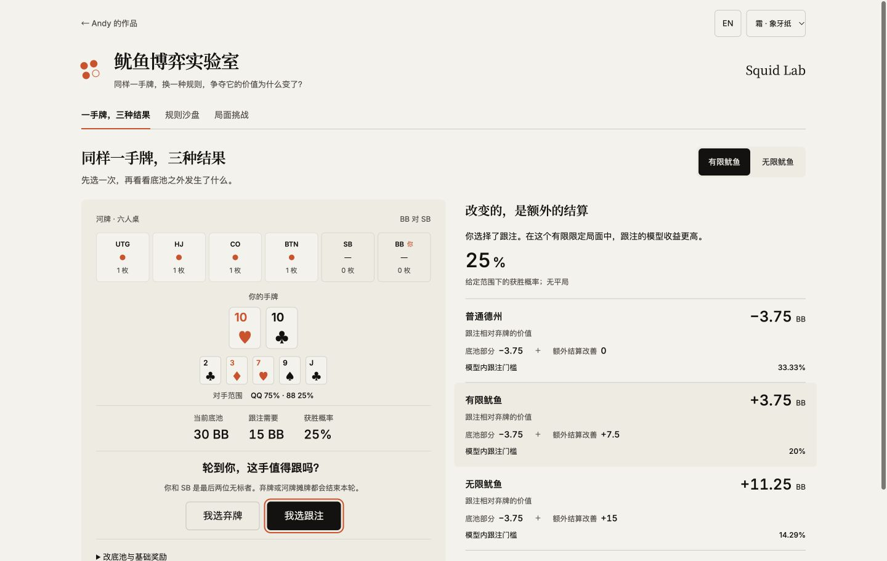

# Squid Lab

[Open the lab](https://andyzhang666666.github.io/poker-squid-lab/) · [Rule sandbox](https://andyzhang666666.github.io/poker-squid-lab/#sandbox) · [Spot challenges](https://andyzhang666666.github.io/poker-squid-lab/#challenges) · [中文](README.md)

The same hand. A different rule. What changes its value?

Choose call or fold before revealing chip EV and side payments under plain Hold’em, finite squid and an explicit infinite preset. Replay main-pot outcomes, inspect every transfer, then practise twelve short spots.

## Three connected workspaces

- **One hand, three outcomes:** an authored river with actual card evaluation and separate chip and side-ledger calculations. Change the pot, call cost or base reward.
- **Rule sandbox:** click a main-pot winner, test chops and reveal conditions, undo and replay events. Each mode settles itself; every transfer is inspectable.
- **Spot challenges:** twelve computed questions, explanations, latest-attempt progress and mistake review.

The sandbox runs 5,000 paired trials in a worker. Both modes receive identical events within each trial. Winner weights and chops are external assumptions; completed and unfinished samples remain visible. Results carry their original conditions, and changed inputs disable the simulation export until a rerun.



The opening sample uses TT against QQ at 75% and 88 at 25% on a specified river. At 25% win probability, a 30BB pot and 15BB call, call-minus-fold is −3.75BB without the side game, +3.75BB in finite mode and +11.25BB in infinite mode. See [the complete assumptions and derivation](docs/METHODS.md).

## Implementation and provenance

One versioned transition engine drives marker awards, replay, settlement, explanations and generated homepage exercise data. Transfers use integer hundredths of a BB. Local imports validate events and answers and recompute saved simulation results. Progress merges by attempt ID; no account or model API is required.

The card/range foundations come from [Poker Lab](https://github.com/AndyZhang666666/poker-ev-calculator), using [phe 0.6.0](https://github.com/thlorenz/phe) under MIT. [boardgame.io](https://github.com/boardgameio/boardgame.io) is a design reference for action logs and replay; its code and multiplayer runtime are not bundled. See [source and licence records](docs/THIRD-PARTY.md).

Finite and infinite house rules are explicit presets based on the linked providers. This is a rule-learning and fixed-assumption experiment, not an adaptive poker strategy solver. The app adds no backend, financial transactions or live-table integration.

## Run and verify

Node.js 22.18+; Next.js 15.5, React 19.1 and TypeScript.

```sh
npm ci
npm run check
npm run build
npm run preview
```

Preview: `http://127.0.0.1:8864/poker-squid-lab/`. Generate the homepage fixture with `npm run preview-data`.

[Executed validation](docs/VALIDATION.md) · [Methods](docs/METHODS.md) · [Changelog](CHANGELOG.md)
