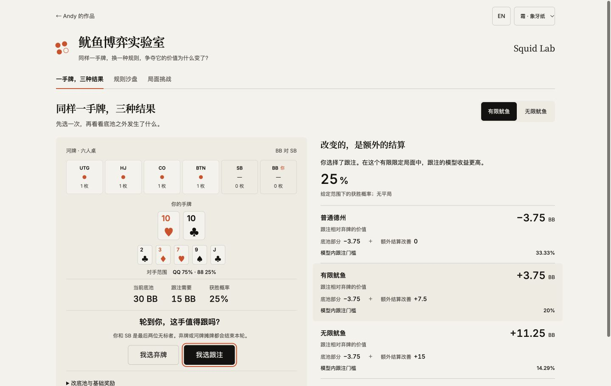
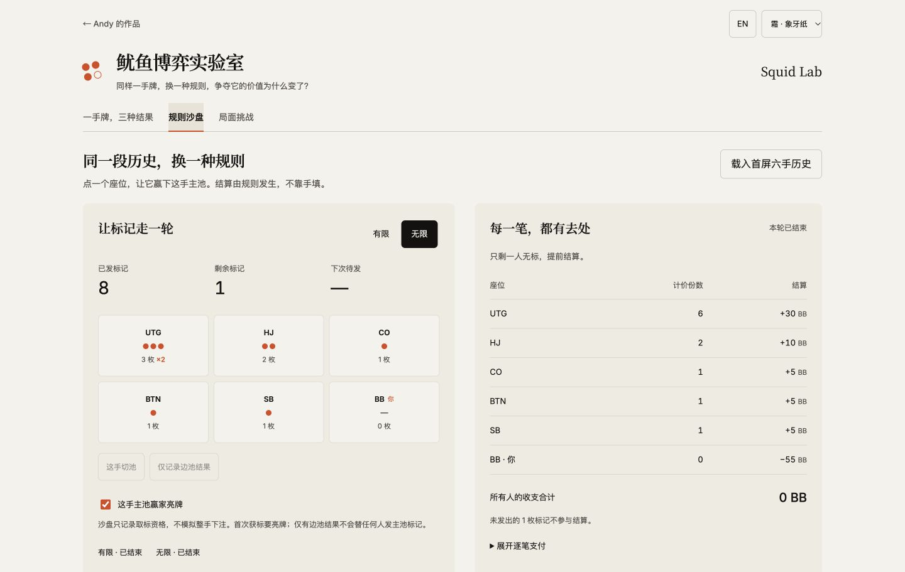

# 鱿鱼博弈实验室 · Squid Lab

[在线体验](https://andyzhang666666.github.io/poker-squid-lab/) · [规则沙盘](https://andyzhang666666.github.io/poker-squid-lab/#sandbox) · [局面挑战](https://andyzhang666666.github.io/poker-squid-lab/#challenges) · [English](README.en.md)

同样一手牌，换一种规则，争夺它的价值为什么变了？

先选跟注或弃牌，再看普通德州、有限鱿鱼和无限鱿鱼的差异。把主池收益与附加结算分开，才能解释同一局面为什么会得到不同结果。

## 从这里开始

| 工作区 | 可以做什么 |
| --- | --- |
| 一手牌，三种结果 | 在明确的河牌局面先作判断，再展开三种规则的收益分解；修改底池、跟注额与基础奖励，检查结论怎样变化 |
| 规则沙盘 | 指定主池赢家，观察重复获标、切池与亮牌条件；逐手回放、撤销，展开实际支付账本 |
| 局面挑战 | 十二道规则、结算与比较题，先作答再看推导；保留最近作答并重练错题 |

沙盘还可以模拟 5,000 轮。每轮两种模式接收同一段赢家与切池事件；你可以修改各座位频率，比较结束时无标的比例、结算分布与轮长。结果保留其输入和种子，改变参数后旧结果会提示重新计算。





截图来自实际验收；挑战进度属于构造的测试记录。

## 首屏的三个数字

六人桌，双方是最后两位无标者；河牌 `2♣ 3♦ 7♥ 9♠ J♣`，你持 `T♥ T♣`，对手范围为 `QQ:75%, 88:25%`。实际组合枚举给出 25% 获胜概率，没有平局。当前底池 30BB 已含对手下注，跟注需要 15BB。

| 比较 | 底池部分 | 相对弃牌的结算改善 | 跟注相对弃牌 |
| --- | ---: | ---: | ---: |
| 普通德州 | −3.75BB | 0BB | −3.75BB |
| 有限鱿鱼 | −3.75BB | ＋7.50BB | ＋3.75BB |
| 无限鱿鱼 | −3.75BB | ＋15BB | ＋11.25BB |

有限与无限使用相同的前六手赢家历史。基础奖励为 5BB；无限模式当前持标为 3、2、1、1、0、0。该比较限定在明示的河牌、范围和结束条件下，完整推导见 [方法说明](docs/METHODS.md)。

## 这次实现的工作

- 将有限与无限鱿鱼写成同一套版本化事件规则，让发标、回放、结算和挑战共用计算结果。
- 用反事实比较展示一手牌的额外价值，避免把整笔惩罚直接加进收益。
- 在独立线程中运行成对模拟，保留频率假设、随机种子和未完成样本，支持中止。
- 实现本地恢复与备份校验；导入会重算模拟核对结果，训练记录按作答 ID 去重合并。
- 沿用官网四套主题、中英文与字体，分别安排桌面比较和手机首屏判断的阅读顺序。

## 来源与范围

牌面计算沿用 [Poker Lab](https://github.com/AndyZhang666666/poker-ev-calculator) 的实际组合、范围权重与抽样基础，评估器使用 [phe 0.6.0](https://github.com/thlorenz/phe)（MIT）。[boardgame.io](https://github.com/boardgameio/boardgame.io) 的动作日志与历史查看是设计参考，本项目没有引入其运行时或复制其多人服务。来源和许可见 [复用记录](docs/THIRD-PARTY.md)。

桌规参考 [Pokr](https://help-center.pokr.win/en/battle/guides/squid/) 和 [BluffKing](https://bluffking.ai/en/blog/poker-squid-game-friend-room/)，并在界面明确首次亮牌、切池累积、提前结束和未发标记的处理。不同桌规不能混作同一规则。

这是本地规则实验和限定场景比较。模拟频率由使用者假设，未求解自适应打法或完整 GTO；没有账号、后台、付费模型或实际支付。

## 开发与验证

Node.js 22.18+，Next.js 15.5、React 19.1、TypeScript，静态导出到 GitHub Pages。

```sh
npm ci
npm run check
npm run build
npm run preview
```

预览地址：`http://127.0.0.1:8864/poker-squid-lab/`。`npm run preview-data` 从规则引擎生成官网短试玩的数据，不另写一套答案。

[实际验收记录](docs/VALIDATION.md) · [规则与公式](docs/METHODS.md) · [更新记录](CHANGELOG.md)
