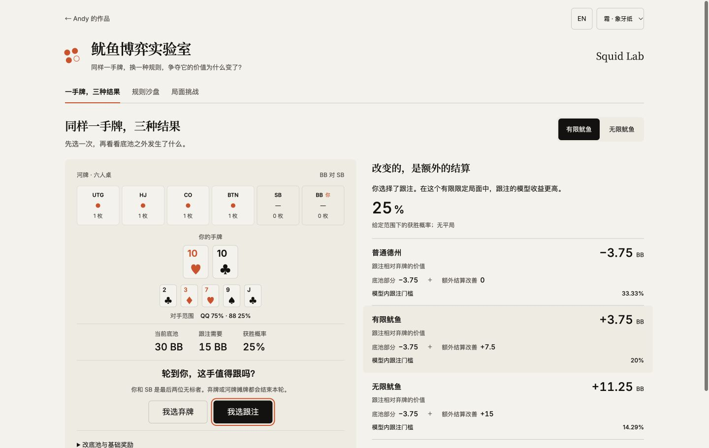
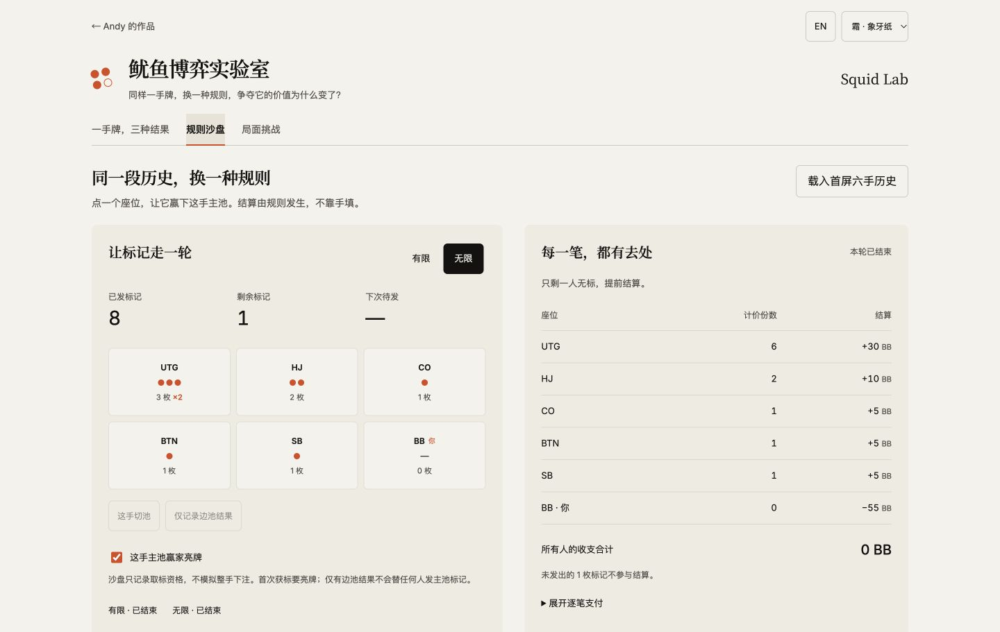
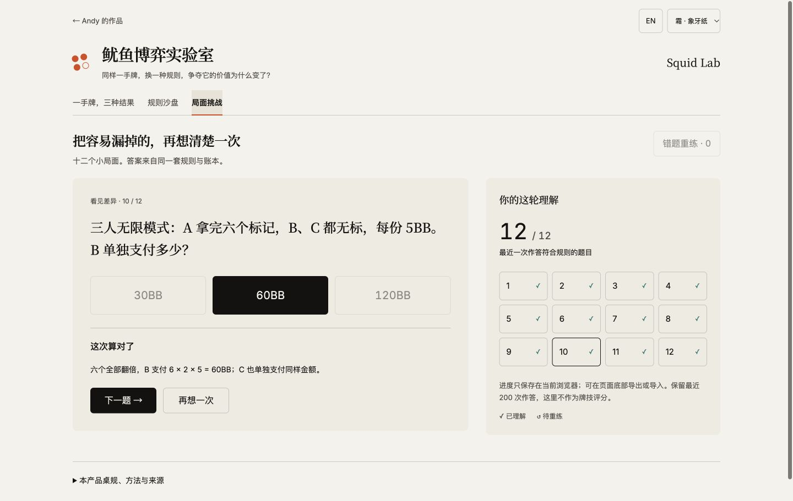
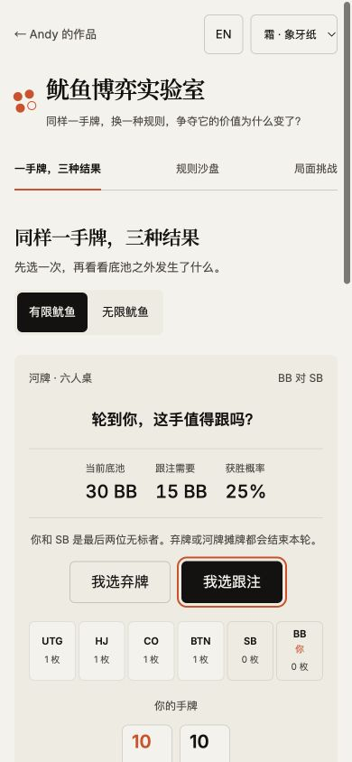

# 实现与实际验证 · 2026-11-07

本轮实现三个工作区、两套明确的鱿鱼桌规，以及官网第四个德州入口。验证使用构造牌面和本机测试记录，未开展真实用户效果研究。

## 自动检查

| 项目 | 执行结果 |
| --- | --- |
| `npm run check` | 14 项 Node 测试通过，无失败、无跳过 |
| 发标与结算 | 有限重复获标、切池、仅边池、首次亮牌、首池双标、切池累积、供应上限、提前结束、多人无标分别支付均覆盖 |
| 账本 | 整数百分之一 BB 转移；三至九人固定种子模拟的全桌平均收支为零；分布计数等于完成样本数 |
| 首屏计算 | 实际牌面/范围枚举为 25% 获胜、零平局；三个相对收益为 −3.75 / ＋3.75 / ＋11.25BB |
| 模拟 | 相同输入与种子逐项一致；等频六人有限轮长接近独立推导的 8.7 手，各座位末位比例与 1/6 对照 |
| 中止 | 用真实 Node 工作线程载入生产计算模块，在进度消息后中止，确认没有提交完成结果 |
| 恢复与导入 | 校验版本、参数、事件、游标、题目与选项、重复作答；篡改的模拟输出被拒绝；完整保留规模可自行导入 |
| 生产构建 | Next.js 静态导出及类型检查通过，保留 `/poker-squid-lab/` 路由前缀与独立计算线程 |

原始输出：[检查](../results/check-20261107.txt)、[构建](../results/build-20261107.txt)、[依赖检查](../results/dependency-audit-20261107.json)。

## 真实浏览器操作

使用静态生产导出的本机预览执行，浏览器为桌面应用的内置浏览器：

1. 首屏选择跟注后，三个比较结果与手算一致；有限/无限切换显示相应的持标状态。
2. 沙盘载入相同六手历史，无限持标为 3、2、1、1、0、0。指定 SB 下一手独赢后，你的支付为 55BB；全桌合计零，剩余一枚不计入结算。
3. 撤销回到未结算，再前进恢复终局。5,000 轮计算线程完成，两个模式都报告完成数和未完成数。
4. 修改种子后保留旧结果、显示条件变化并禁用模拟导出；重新计算后显示新种子。原频率和切池条件可展开检查。
5. 十二题逐题作答均能得到相应解析；先构造错题，再进入重练答对，错题数量和进度随之变化。刷新后保留进度与模拟结果。
6. 通过界面下载的备份由生产解码器重新校验：包含 14 次构造作答、7 个事件及 5,000 轮模拟。再次导入后按 ID 合并，无重复；无效版本文件被拒绝，当前记录保留。
7. 三个工作区在 1440、768、390、360px 的实际视口均无页面横向溢出，详见 [宽度记录](viewport-checks-20261107.json)。英文三个工作区另在 390px 检查。
8. 四个主题实际改变页面底色与文字变量；键盘左右箭头可切换工作区并更新选中状态。显式减少动效后，工作区计算样式为 `animation-name: none`。

最后一轮浏览器错误日志为空。该记录没有将源代码检查写成跨浏览器、读屏或实体手机验收；原生 Safari 与系统减少动效偏好的完整设备矩阵尚未逐项执行。

## 界面复核中修正的内容

- 桌面首次检查时，操作按钮被上方留白挤到首屏之外；调整头部与比较密度后恢复直接操作。
- 手机先展示底池、跟注额、获胜概率和判断按钮，再查看完整牌面与标记，主要按钮在 390×844px 首屏内。
- 导入后参数输入框同步到恢复值，避免结果属于新参数、控件仍显示旧参数。
- 补齐原始模拟条件查看入口；终局禁用座位按钮时保留标记数据的可读性。
- 对齐官网当前的象牙纸、深海、赤砂与苔原配色，保留原主题 ID，实际检查四组底色与文字变量。

## 官网与发布边界

官网集成在独立分支维护，原 17 项作品和个人资料逐项对照保留，新增第 18 项与其案例页。历史投屏发布检查与本轮新增模块检查分开；当前原有模块保护仍执行。

上线以主分支对应的 GitHub Actions 和公开页面实际操作为准。本地验证记录与正式部署记录分开，后者可从仓库 Actions 和提交历史核查。
